# Robofael 🤖

[](.github/workflows/ci.yml)


Assistente pessoal de atividades diárias com **avatar animado feito a partir de fotos reais**.
Ele **ouve** pelo microfone, **pensa** com o Claude (ou em modo offline) e **responde falando**:
a boca acompanha a voz e o tom de voz é ajustado ao do usuário.

- 👂 **Mãos livres**: diga **"ok Fael"** para chamar o assistente. A frase é detectada localmente, sem enviar o áudio do ambiente para a internet.
- 🗣️ **Conversa fluida**: a resposta começa a ser falada enquanto ainda está sendo gerada.
- 🎙️ **Microfone com detecção de fala**: as barras mostram o nível real da sua voz, e a escuta é cancelável.
- 📋 **Tarefas e lembretes** por voz ou clique, com aviso falado no horário exato.
- 🧠 **Memória de longo prazo** (SQLite) com **histórico auditável**: pergunte *"o que eu fiz ontem?"*, *"…na semana passada?"*, *"…no dia 20?"*.
- 🖥️ **Abre programas instalados** no Linux: *"abre o navegador"*, *"abre a calculadora"*, *"abre as configurações"*.
- ⚙️ **Tela de configurações**: idioma, avatar, voz (voz base, tom e ritmo, com teste), microfone, ativação por voz e inicialização, salvos entre sessões.
- 🎤 **Escolha do microfone** entre os conectados ao computador, trocando na hora (sem reabrir o app).
- 🚀 **Abre junto com o computador** e com o comando `robofael` em qualquer terminal, se você quiser.
- 💾 **Banco onde você quiser e backup com um clique**: mude o `memoria.db` de pasta (ex.: uma pasta sincronizada) e salve cópias conferidas, com o assistente aberto.
- 🔎 **Mostra o cérebro em uso** (Claude, Ollama ou offline) e os modelos compatíveis de cada um.
- 🌎 **Português ou inglês**: responde, fala e mostra a interface no idioma configurado — e entende comandos nos dois.
- 🧑 **Avatar em busto** com camisa futurista, boca animada por volume e formato de vogal, a 60 fps.
- 🎚️ **Voz com o seu tom**, a partir de um perfil gravado em 1 minuto.
- 📴 **Modo offline**: funciona sem chave de API, com comandos básicos.

---

## Sumário

1. [Instalar no Ubuntu](#instalar-no-ubuntu-pacote-deb)
1. [Início rápido (desenvolvimento)](#início-rápido-desenvolvimento)
2. [Uso](#uso)
3. [Configuração](#configuração) · [Cérebro local (Ollama)](#cérebro-local-ollama)
4. [Arquitetura](#arquitetura)
5. [Fluxos de execução](#fluxos-de-execução)
6. [Desempenho](#desempenho)
7. [Decisões de arquitetura](#decisões-de-arquitetura)
8. [Desenvolvimento](#desenvolvimento)
9. [Dados e privacidade](#dados-e-privacidade)
10. [Solução de problemas](#solução-de-problemas)

---

## Instalar no Ubuntu (pacote .deb)

O instalador padrão é um pacote `.deb`, feito para o **Ubuntu 24.04**. Ele já traz as dependências Python e o modelo de voz, então a instalação funciona **sem internet**.

```bash
make deb                                           # gera dist/robofael_3.9.1_amd64.deb
sudo apt install ./dist/robofael_3.9.1_amd64.deb   # o apt instala Python, Tk, PortAudio...
```

Depois disso:
- **Abrir:** procure **Robofael** no menu de aplicativos ou rode `robofael` no terminal. **Robofael — gravar minha voz** também aparece no menu.
- **Seus dados** (agenda, histórico, preferências e gravações) ficam em `~/.local/share/robofael`, separados por usuário. O cache fica em `~/.cache/robofael`.
- **Atualizar:** gere a nova versão e rode o mesmo `sudo apt install ./dist/robofael_<versão>_amd64.deb`. Os dados são mantidos.
- **Remover:**
  - `sudo apt remove robofael` remove o programa e mantém os seus dados;
  - `sudo apt purge robofael` também apaga `/opt/robofael`;
  - os dados pessoais só saem se você apagar `~/.local/share/robofael`.
- **Testar o pacote sem instalar:** `make testar-deb`. Ele instala numa pasta temporária e verifica a integridade, o ambiente, os lançadores, onde os dados são gravados e a remoção.

Detalhes do pacote:

| Item | Onde fica |
|---|---|
| Programa (venv criado na instalação) | `/opt/robofael/venv` |
| Dependências Python (wheels) e modelo do Vosk | `/opt/robofael/wheels`, `/opt/robofael/modelos` |
| Fotos do avatar | `/opt/robofael/assets` |
| Comandos | `/usr/bin/robofael`, `/usr/bin/robofael-gravar-voz` |
| Menu e ícone | `/usr/share/applications/robofael*.desktop`, `/usr/share/icons/hicolor/*/apps/robofael.png` |

- **Versão do Python:** as wheels são construídas para o Python da máquina que gera o pacote. Para outra versão do Ubuntu, rode `make deb` nela.
- **Fotos:** o pacote inclui as fotos de `assets/avatares/`. Lembre-se disso antes de distribuí-lo.

## Início rápido (desenvolvimento)

**Requisitos:**
- Linux (testado no Ubuntu) com Python 3.10 ou superior.
- Tk e PortAudio: `sudo apt install python3-tk portaudio19-dev python3-pyaudio`.
- Internet, para o reconhecimento de fala e a voz neural.

```bash
git clone git@github.com:LourencoCosta/robofael-perssonal-assistant.git robofael && cd robofael
make instalar                        # .venv + pacote + ferramentas de dev + pre-commit + modelo de voz local (~31 MB)
export ANTHROPIC_API_KEY=sua-chave   # opcional; sem ela usa o Ollama local ou o modo offline
make executar                        # ou: make executar ARGS="--avatar selfie --continuo"
```

**Fotos do avatar:** são pessoais e não estão no repositório. Coloque as suas em `assets/avatares/`, seguindo [`assets/avatares/LEIAME.md`](assets/avatares/LEIAME.md). Sem elas o assistente funciona, mas sem o avatar.

Outras formas de abrir: `scripts/iniciar.sh`, `.venv/bin/robofael` e `.venv/bin/python -m robofael`.
Para registrar a sua voz: `make gravar-voz`. `make` sem argumentos lista todos os comandos.

## Uso

| Ação | Como |
|---|---|
| Chamar o assistente sem as mãos | Diga **"ok Fael"**: um bipe confirma e ele ouve o comando |
| Chamar e já mandar o comando | **"ok Fael, anota tarefa comprar pão"**, numa frase só, sem bipe |
| Falar / cancelar a escuta / interromper a resposta | `ESPAÇO` ou botão 🎤 (o rótulo muda conforme o estado) |
| Digitar em vez de falar | caixa de texto + `ENTER` (`ESC` sai da caixa); se ele estiver falando ou ouvindo, para e atende o pedido novo |
| Interromper | `ESC` |
| Concluir ou reabrir uma tarefa | duplo clique (ou `ENTER`) no painel |
| Remover uma tarefa ou lembrete | selecionar + `Delete` |
| Trocar o avatar | `T`, ou ⚙ → Avatar |
| Salvar a última resposta num arquivo | **"gerar doc"** (ou "gerar doc dessa resposta") |
| Escrever um documento sobre um assunto | **"gerar doc sobre <assunto>"**: só a confirmação é falada |
| Ajustar voz, avatar, microfone, ativação por voz e inicialização | botão **⚙** (ao lado do 🎤) |
| Ver o modelo de linguagem em uso e os disponíveis; mudar o banco de lugar ou fazer backup | botão **⚙** → seções de baixo |
| Fechar | `Ctrl+Q` |

**Gerar documento:**
- "gerar doc" salva a última resposta do assistente;
- "gerar doc sobre energia solar" pede ao modelo um texto completo sobre o assunto. O documento não é lido em voz alta: o assistente avisa que vai escrever, mostra o texto na legenda enquanto escreve e diz onde salvou.

Os arquivos ficam em `~/Documentos/Robofael` (ou `~/Documents/Robofael`), em Markdown: `2026-10-29 1015 - energia-solar.md`, com título, data, pedido e conteúdo. Nada é sobrescrito: um nome repetido ganha " (2)".

Também entende "gera um documento sobre…", "faça um doc…", "generate a doc about…" e "gerar dock" (como o reconhecimento de fala às vezes escreve). Funciona com o Claude, com o modelo local e no modo offline; no offline, o assunto vai como comando ("gerar doc das minhas tarefas pendentes"). No processador, o modelo local leva cerca de 1 a 1,5 minuto para escrever um documento de ~350 palavras.

**Exemplos de fala:**
- "anota tarefa revisar o PR"
- "quais são minhas tarefas?"
- "terminei a tarefa 2"
- "me lembra daqui a 20 minutos de beber água"
- "amanhã às 9 me lembra da daily" (exige o Claude)
- "o que eu fiz ontem?", "o que concluí na semana passada?", "o que eu fiz no dia 20/10?"
- "abre o navegador", "abrir a calculadora", "abre o FileZilla"
- "nova conversa"
- no modo contínuo, "tchau" encerra a conversa

## Configuração

| Variável | Padrão | Descrição |
|---|---|---|
| `ANTHROPIC_API_KEY` | — | Ativa o Claude; sem ela, usa o modelo local (Ollama) ou o modo offline |
| `ROBOFAEL_CEREBRO` | `auto` | `auto` (Claude → Ollama → offline), `claude`, `ollama` ou `offline` |
| `ROBOFAEL_OLLAMA_URL` | `http://localhost:11434` | Servidor do Ollama |
| `ROBOFAEL_OLLAMA_MODELO` | `llama3.2:3b` | Modelo local (sem ele instalado, usa o primeiro que aceite ferramentas) |
| `ROBOFAEL_USUARIO` | `Rafael` | Nome usado nas saudações e nas instruções do modelo |
| `ROBOFAEL_ASSISTENTE` | `Robofael` | Nome do assistente (título, saudação e como ele se apresenta) |
| `ROBOFAEL_ATIVACAO` | `1` | `0` desliga a escuta de "ok Fael" (o mesmo que `--sem-ativacao`) |
| `ROBOFAEL_IDIOMA` | `pt-BR` | `en-US` para responder em inglês (o mesmo que `--idioma en-US` ou ⚙ → Idioma) |
| `ROBOFAEL_FRASE_ATIVACAO` | `ok Fael` | Frase que chama o assistente (só "ok Fael" tem gramática calibrada) |
| `ROBOFAEL_MODELOS` | `./modelos` | Onde fica o modelo do Vosk (`make baixar-modelo-voz`) |
| `ROBOFAEL_MODELO` | `claude-opus-5-5` | Modelo do Claude |
| `ROBOFAEL_VOZ` | `pt-BR-AntonioNeural` | Voz neural padrão (o perfil gravado tem prioridade) |
| `ROBOFAEL_DADOS` | `./dados` | `memoria.db` (agenda, histórico e preferências), perfil e gravações de voz |
| `ROBOFAEL_CACHE` | `./.cache` | Quadros do avatar e falas sintetizadas |
| `ROBOFAEL_ASSETS` | `./assets` | Fotos dos avatares |
| `ROBOFAEL_DOCUMENTOS` | `<Documentos>/Robofael` | Onde o "gerar doc" salva os arquivos (a pasta de documentos vem do XDG: `Documentos` ou `Documents`) |

Até a versão 3.4.0 as variáveis se chamavam `EUROBO_*`. Esses nomes ainda são aceitos quando a `ROBOFAEL_*` correspondente não está definida, com um aviso no log; os comandos antigos `eurobo` e `eurobo-gravar-voz` também continuam funcionando no ambiente de desenvolvimento.

### Microfone

Em ⚙ → **Microfone**, escolha entre os microfones conectados ou deixe **Padrão do sistema** (o mesmo das Configurações do Ubuntu). A troca vale na próxima vez que o assistente ouvir, com uma nova calibração do ruído, e também para a escuta de "ok Fael" e para o `robofael-gravar-voz`.

- A lista vem do servidor de áudio (`pactl list sources`, PipeWire ou PulseAudio), sem os "monitores" das saídas de som.
- O microfone continua sendo aberto pelo dispositivo padrão do ALSA. A escolha vai nas variáveis `PIPEWIRE_NODE`/`PULSE_SOURCE`, definidas só durante a abertura, para não passar para os programas que o assistente abre. Abrir o `hw:` direto disputaria o aparelho com o PipeWire e exigiria taxa e canais exatos.
- Se o microfone escolhido for desconectado, ele continua selecionado na tela, marcado como *(desconectado)*, e o servidor de áudio usa o padrão do sistema até ele voltar.

### Inicialização

Em ⚙ → **Inicialização**:

| Opção | O que faz | Para desfazer |
|---|---|---|
| Abrir ao entrar no computador | Cria `~/.config/autostart/robofael.desktop` (o GNOME abre o app 5 s depois do login) | Desmarcar, ou apagar o arquivo |
| Abrir com o comando `robofael` no terminal | Cria em `~/.local/bin` atalhos para `robofael` e `robofael-gravar-voz` (o `~/.profile` do Ubuntu já põe essa pasta no PATH) | Desmarcar (só apaga atalhos que apontam para este programa) |

- Instalado pelo `.deb`, o comando já existe em `/usr/bin` e a segunda opção aparece marcada e bloqueada. Nesse caso, o atalho de login usa o `/usr/bin/robofael`, que define as pastas de dados.
- No modo de desenvolvimento, os atalhos apontam para `.venv/bin/robofael`: se a pasta do projeto mudar de lugar, desmarque e marque de novo.
- Aberto pelo login, o app **não lê o `~/.bashrc`**. Variáveis como `ANTHROPIC_API_KEY` precisam estar em `~/.config/environment.d/robofael.conf` (uma `NOME=valor` por linha) ou no `~/.profile`, e só valem depois de sair e entrar de novo na sessão.

Parâmetros finos ficam em [`configuracao.py`](src/robofael/configuracao.py): pausa de fim de fala, limite do histórico, timeout da API e tamanho do cache de voz.

### Modelo de linguagem em uso

Em ⚙ → **Assistente (modelo de linguagem)** aparecem:
- **Em uso:** quem está gerando as respostas, por exemplo "Ollama (local) · llama3.2:3b", "Claude (nuvem) · claude-opus-5-5" ou "modo offline".
- **Modelos compatíveis** de cada provedor, consultados ao abrir a tela, em segundo plano:
  - **Claude:** os modelos liberados para a sua chave (`models.list` da API). Sem chave, a linha explica o motivo.
  - **Ollama:** os modelos instalados que conversam **e** chamam ferramentas (`capabilities` com `completion` e `tools`, via `/api/show`), com o tamanho. Modelos só de embeddings ou sem ferramentas ficam de fora, porque não conseguem mexer na agenda.

A tela só mostra. Para trocar, use `ROBOFAEL_CEREBRO`, `ROBOFAEL_MODELO` (Claude) e `ROBOFAEL_OLLAMA_MODELO`; a troca vale ao reabrir.

### Memória (banco SQLite)

Em ⚙ → **Memória (banco SQLite)**, que vale na hora, sem precisar de Salvar:

- **Mudar local…:** escolha uma pasta, e o banco passa a ser `<pasta>/memoria.db`, sem fechar o assistente.
  - A cópia é feita pela API de backup do SQLite (consistente mesmo com o banco em uso) e conferida com `PRAGMA integrity_check` antes da troca.
  - O arquivo antigo **não é apagado**: vira `memoria.db.movido-<data>` onde estava.
  - Se a pasta já tiver um `memoria.db`, a mudança é recusada (nada é sobrescrito).
  - O local escolhido fica em `<dados>/local_banco.json` e vale nas próximas aberturas, inclusive para o `make integridade` e o `robofael-gravar-voz`. Voltar para a pasta de dados apaga esse registro.
  - Se o banco escolhido não estiver lá ao abrir (pendrive ou disco de rede desconectado), o assistente avisa e usa o banco padrão só naquela vez, sem criar um banco vazio no lugar e sem esquecer a escolha.
- **Fazer backup…:** salva uma cópia num arquivo único (sem `-wal`), conferida e com o número de registros do histórico. O nome sugerido é `robofael-memoria-<data>.db`. Para restaurar, feche o assistente e copie o backup por cima do `memoria.db`.

Só o banco muda de lugar: o perfil e as gravações da voz continuam em `ROBOFAEL_DADOS`.

## Cérebro local (Ollama)

Sem o Claude, o Robofael usa um modelo local do [Ollama](https://ollama.com) e, se o Ollama não responder, o modo offline de sempre. Para usar:

```bash
ollama pull llama3.2:3b
```

O log da abertura diz quem está pensando: `Cérebro: modelo local llama3.2:3b (Ollama em http://localhost:11434)`.

Modelos pequenos rodando no processador conversam bem, mas escolhem ferramentas mal. Nos testes, "me conta uma curiosidade" abriu o navegador. Por isso a resposta é montada em camadas ([`adaptadores/ollama.py`](src/robofael/adaptadores/ollama.py)):

| Fala | Quem responde |
|---|---|
| Comando que o modo offline reconhece ("anota tarefa…", "que horas são", "abre o navegador", "o que eu fiz ontem") | O modo offline: na hora e sempre igual |
| Pedido de agenda em linguagem livre ("amanhã às 9 me lembra da reunião") | O modelo, só com as ferramentas do assunto e só as seguras (criar e consultar); ele diz "Só um instante." enquanto pensa |
| Conversa ("quem foi Santos Dumont?") | O modelo, sem ferramentas, falando enquanto escreve |
| Ollama fora do ar ou falhando | O modo offline, como antes; o Ollama é tentado de novo depois de 30 s |

Concluir, remover tarefas e abrir programas ficam só com os comandos explícitos. Chamadas de ferramenta que o modelo escreve como texto JSON são executadas ou descartadas: nunca são lidas em voz alta.

**Desempenho medido** (llama3.2:3b, i7 sem GPU, com outro programa usando o mesmo Ollama):
- primeira palavra numa conversa: 1 a 2,5 s;
- pedido com ferramentas: de 15 a 45 s, conforme a carga da máquina (o aviso sai na hora).

O tempo é gasto lendo o pedido. Por isso cada pedido leva só as ferramentas do assunto, e o histórico é compactado depois de cada troca. O Ollama atende um pedido por vez: outro programa usando o mesmo servidor atrasa as respostas.

---

## Idiomas

O Robofael responde em **português (pt-BR)** ou **inglês (en-US)**. Para escolher o idioma, use uma destas opções (a primeira da lista prevalece sobre as seguintes):

1. **⚙ → Idioma**, que troca na hora e fica salvo;
2. `--idioma en-US` na linha de comando;
3. a variável de ambiente `ROBOFAEL_IDIOMA=en-US`.

| Muda com o idioma | Fica igual |
|---|---|
| Respostas faladas e legendas, modo offline, "o que eu fiz", programas, saudação e lembretes | A frase de ativação ("ok Fael") |
| Interface: status, botões, painel, atalhos e configurações | O texto das suas tarefas (não é traduzido) |
| Reconhecimento de fala (`pt-BR`/`en-US`), voz neural (Antonio → Andrew) e voz de reserva (gTTS) | O histórico e as preferências |
| Instruções do Claude (troca → conversa nova) e formatos de data (21/10 → 10/21) | |

**Entender** é independente do idioma: "anota tarefa…" e "add task…", "o que eu fiz ontem?" e "what did I do yesterday?", "abre a calculadora" e "open the calculator" funcionam sempre. Só datas numéricas seguem o idioma: em português 05/10 é 5 de outubro; em inglês, é 10 de maio.

Todas as mensagens ficam em [`i18n.py`](src/robofael/i18n.py), com as duas línguas lado a lado. Um teste garante que nenhuma tradução está faltando e que os campos de formatação (`{n}`, `{texto}`...) são os mesmos nas duas versões. Para adicionar um idioma:

1. acrescente um valor em `Idioma`;
2. traduza as mensagens do `CATALOGO`;
3. inclua as vozes em `VOZES`;
4. registre os dias da semana em `DIAS_SEMANA`.

## Arquitetura

O projeto segue **arquitetura hexagonal (portas e adaptadores)**:
- O **domínio** e a **aplicação** não conhecem nenhuma tecnologia.
- Claude, Google Speech, edge-tts, pygame, JSON e Tk entram por **adaptadores** que implementam **portas** (`typing.Protocol`).
- Só a **raiz de composição** (`bootstrap.py`) conhece as implementações concretas.

```mermaid
flowchart TB
    subgraph apresentacao["apresentação (Tk) — só a thread principal"]
        JAN[Janela]
        PAL[Palco<br/>avatar · halo · barras · legendas]
        PAI[PainelAgenda]
        GRA[Gravador de voz]
    end

    subgraph aplicacao["aplicação (casos de uso)"]
        ORQ[Orquestrador<br/>pipeline em streaming]
        BAR[[Barramento de eventos]]
        AGD[AgendadorLembretes]
        DIV[DivisorFrases]
    end

    subgraph dominio["domínio (puro)"]
        AGE[Agenda]
        MOD[Tarefa · Lembrete]
        EST[MaquinaEstados]
        EVT[Eventos]
        LIN[linguagem]
    end

    subgraph portas["portas (Protocol)"]
        P1([ModeloLinguagem])
        P2([ReconhecedorFala])
        P3([SintetizadorVoz])
        P4([ReprodutorAudio])
        P5([RepositorioAgenda])
        P6([DetectorAtivacao])
        P7([ConsultaHistorico])
        P8([LancadorProgramas])
    end

    subgraph adaptadores
        SQL[(BancoSqlite<br/>agenda · histórico · preferências)]
        LNX[LancadorLinux<br/>.desktop + gtk-launch]
        VOS[AtivacaoVosk<br/>escuta passiva local]
        CLA[ModeloClaude<br/>streaming + tools]
        OFF[ModeloOffline]
        MIC[MicrofoneGoogle<br/>VAD próprio]
        TTS[SintetizadorEdge<br/>cache LRU]
        REP[ReprodutorPygame]
        JSN[RepositorioJson<br/>escrita atômica]
    end

    subgraph puros["núcleos puros"]
        AUD[audio: análise · VAD · perfil]
        AVA[avatar: renderizador · animação]
    end

    BOOT{{bootstrap<br/>raiz de composição}}

    JAN --> PAL & PAI
    JAN -- comandos --> ORQ
    BAR -- eventos --> JAN
    ORQ --> BAR & EST & DIV
    ORQ --> P1 & P2 & P3 & P4 & P6
    VOS -.-> P6
    SQL -.-> P5 & P7
    LNX -.-> P8
    MEM[Memoria] --> P7
    PRG[ServicoProgramas] --> P8
    CLA & OFF --> MEM & PRG
    AGD --> AGE
    AGE --> P5
    CLA & OFF -.implementam.-> P1
    MIC -.-> P2
    TTS -.-> P3
    REP -.-> P4
    JSN -.-> P5
    CLA --> AGE
    REP & MIC --> AUD
    PAL --> AVA
    BOOT -. monta .-> ORQ & AGD & CLA & MIC & TTS & REP & JSN
```

### Camadas

| Camada | Módulos | Regra |
|---|---|---|
| **Domínio** | `dominio/agenda.py`, `modelos.py`, `repositorios.py`, `estados.py`, `eventos.py`, `linguagem.py`, `periodos.py`, `programas.py`, `ativacao.py` | Python puro; nenhum I/O; declara o contrato de persistência de que precisa |
| **Portas** | `portas.py` | Contratos (`Protocol`) pequenos que a aplicação usa |
| **Aplicação** | `aplicacao/orquestrador.py`, `pipeline.py`, `vigia.py`, `sessao.py`, `memoria.py`, `programas.py`, `barramento.py`, `agendador.py`, `frases.py` | Casos de uso e políticas, via portas; concorrência controlada |
| **Adaptadores** | `adaptadores/claude.py`, `offline.py`, `ferramentas.py`, `sqlite.py`, `microfone.py`, `ativacao_vosk.py`, `sintetizador.py`, `reprodutor.py`, `programas_linux.py`, `repositorio_json.py` (só migração) | Tecnologias concretas, substituíveis |
| **Núcleos puros** | `audio/` (tom, envelope, VAD, perfil), `avatar/` (renderização, animação) | numpy/Pillow; sem hardware |
| **Apresentação** | `apresentacao/app.py`, `palco.py`, `cena.py` (canvas diferencial), `laco.py` (quadros adaptativos e fila com orçamento), `painel.py`, `gravador.py`, `tema.py` | Tk; só a thread principal toca nos widgets |
| **Composição** | `bootstrap.py`, `configuracao.py` | Monta o grafo de objetos (só ele conhece adaptadores); configuração imutável |

A regra de dependência (camadas externas dependem das internas, nunca o contrário) é **verificada por teste**: [`tests/test_arquitetura.py`](tests/test_arquitetura.py) lê os `import` de cada módulo e falha se uma camada importar outra que não lhe é permitida.

### SOLID e código limpo

| Princípio | Onde aparece |
|---|---|
| **S** — responsabilidade única | `Orquestrador` só coordena; `PipelineFala` transforma texto em fala; `VigiaAtivacao` cuida da escuta passiva; `sessao.py` guarda as políticas (voz, idioma, saudação); `bootstrap.py` só monta; a `Janela` só desenha e repassa eventos |
| **O** — aberto/fechado | Intenções do modo offline, ferramentas do Claude e expressões de período são **tabelas**: estender é acrescentar uma entrada, sem editar o despacho |
| **L** — substituição de Liskov | `BancoSqlite` cumpre todos os contratos de persistência (testado); o `RepositorioJson` legado **não** declara o contrato da agenda, porque não guarda o histórico |
| **I** — segregação de interfaces | Portas pequenas: `ConsultaHistorico`, `RepositorioPreferencias`, `SintetizadorConfiguravel`, `CapturaAudio`; cada serviço depende só do que usa |
| **D** — inversão de dependência | Domínio e aplicação dependem de `Protocol`s; a `Agenda` funciona com um repositório em memória (testado); adaptadores só são criados na raiz de composição |

O `ruff` impõe no CI: complexidade ciclomática ≤ 10 por função, funções curtas, nomes no padrão e nenhum parâmetro sem uso.

### Estrutura

```
EuRobo/
├── assets/avatares/              # fotos de origem
├── src/robofael/
│   ├── dominio/                  # entidades, regras, estados, eventos
│   ├── portas.py                 # contratos da arquitetura hexagonal
│   ├── aplicacao/                # orquestrador, pipeline, vigia, sessão, memória, agendador...
│   ├── adaptadores/              # Claude, offline, ferramentas, SQLite, microfone, Vosk, TTS, áudio, programas, inicialização
│   ├── audio/                    # DSP puro: tom, envelope, VAD, perfil de voz
│   ├── avatar/                   # catálogo, renderizador (paralelo + cache), animação
│   ├── apresentacao/             # janela, palco, painel, gravador, tema
│   ├── i18n.py                   # idiomas, catálogo de mensagens e Tradutor
│   ├── bootstrap.py              # raiz de composição
│   └── configuracao.py
├── tests/                        # 546 testes (pytest), inclusive de arquitetura e de desempenho
├── empacotamento/                # instalador .deb (scripts, atalhos, ícone, construção e teste)
├── docs/monografia/              # monografia (TCC, ABNT) em LaTeX + PDF
├── .github/workflows/ci.yml      # lint + tipos + testes (Xvfb)
├── .pre-commit-config.yaml
├── CHANGELOG.md · Makefile · pyproject.toml
└── dados/ · .cache/ · modelos/   # gerados/baixados (ignorados pelo git)
```

---

## Fluxos de execução

### 1. Inicialização (janela em menos de 1 s)

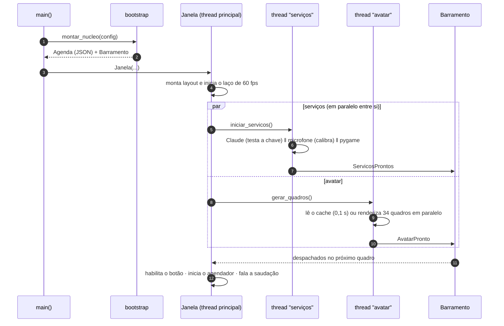

### 2. Conversa em pipeline (o coração do sistema)

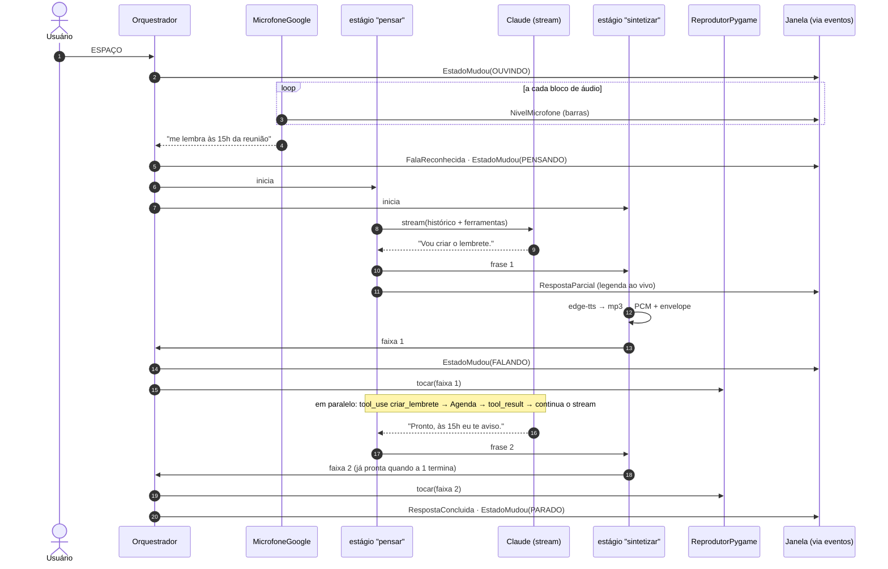

**Cancelamento:** um único `threading.Event` por interação é observado pelos três estágios.
- O microfone para de gravar, o reprodutor para o áudio e o gerador do modelo é fechado, o que encerra o stream HTTP e desfaz a rodada no histórico.
- A interface é liberada em cerca de 10 ms. Os estágios terminam em segundo plano, e a interação seguinte espera por eles antes de usar o histórico.

### 3. Ativação por voz: "ok Fael"

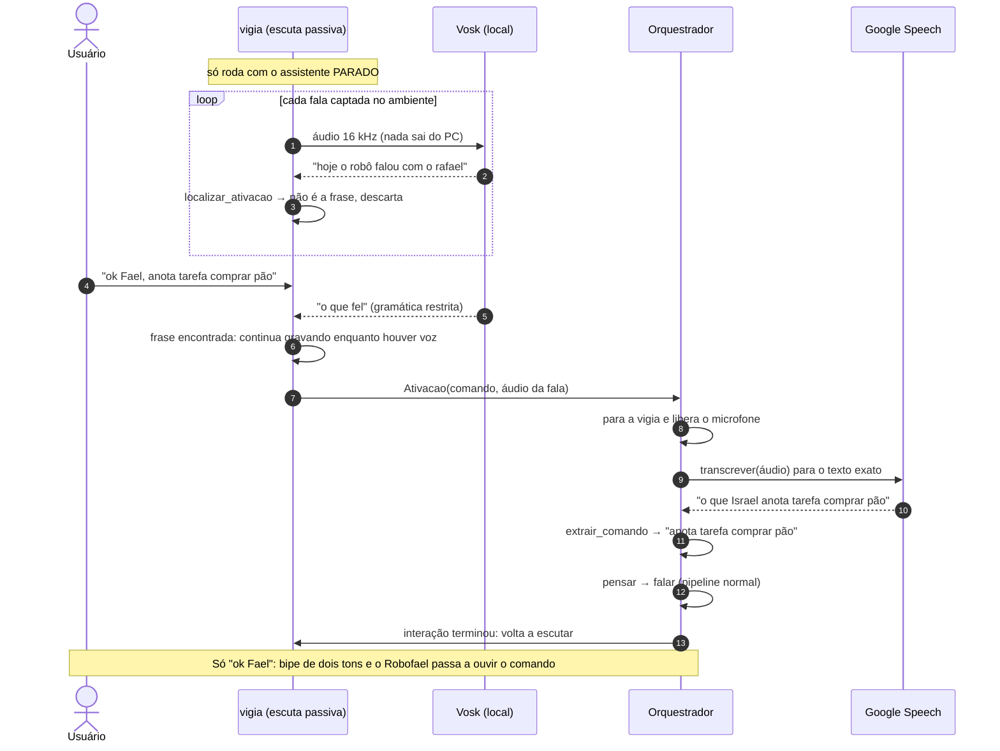

**Por que uma gramática restrita?** "Fael" é curto e não existe no vocabulário do modelo local. Na transcrição livre ele some: *"Ok Fael"* vira *"ok"*, *"o que saiu"* ou *"o que foi"*.
- Para "ok Fael", o Vosk roda com uma **gramática** ([`dominio/ativacao.py`](src/robofael/dominio/ativacao.py)): só pode escolher entre as variantes aceitas (*"ok fel"*, *"o que fel"*...) e **frases distratoras** comuns (*"o que foi"*, *"o que fez"*, *"ok rafael"*, *"quero"*...), que absorvem tudo o que não é a frase.
- Calibrada com 5 vozes sintéticas, incluindo a do seu perfil:
  - **0 falsos positivos em 115** frases parecidas (*"Ok, Rafael"*, *"O que foi que aconteceu?"*, *"Ok, que legal"*...);
  - **8 de 8 acertos na sua voz**.
- Para frases sem gramática calibrada (definidas em `ROBOFAEL_FRASE_ATIVACAO`), vale a busca fonética livre: normalização `qu→k`, `ou→o`, `ie→e`... e limiares por posição.

**O comando junto com a frase:** com uma pausa curta, *"ok Fael, anota tarefa..."* chega em duas falas.
- Depois de detectar a frase, a escuta passiva continua gravando enquanto houver voz (detecção por energia sobre o piso de ruído recente).
- Esse trecho vai ao Google, e a frase é retirada do texto, mesmo quando ele a transcreve como *"o que Israel"* ou *"Ok Fael"*.
- Se você ficar em silêncio por cerca de 0,9 s, toca o bipe e o Robofael passa a ouvir.

O microfone nunca é disputado: qualquer interação (ESPAÇO, texto ou lembrete) cancela a vigia e espera ela fechar o microfone antes de abri-lo.

### 4. Memória de longo prazo: "o que eu fiz?"

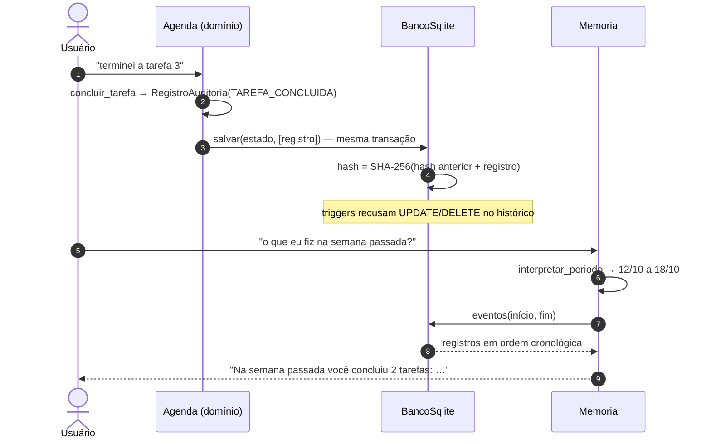

- **O que é registrado:** tarefa criada, concluída, reaberta e removida; lembrete criado, avisado e removido.
- **Cada registro guarda:** data/hora e a descrição do item naquele momento, então o histórico sobrevive mesmo se a tarefa for apagada.
- **Contagem:** uma tarefa concluída e reaberta no mesmo período não conta como feita.
- **Períodos reconhecidos:** hoje, ontem, anteontem, dias da semana ("na segunda"), "dia 20", "20/10", "5 de outubro", "semana passada", "nesta semana", "semana do dia 5/10", "últimos 7 dias", "mês passado" e "este mês". Sempre se referem ao passado.
- **Auditoria:** `make integridade` recalcula a cadeia de hashes e aponta o primeiro registro alterado, removido ou inserido por fora do sistema.
- **Migração:** na primeira execução, a agenda do `agenda.json` (versões anteriores) é importada para o banco e o JSON é renomeado para `.migrado-<data>`, sem nada ser apagado.

### 5. Abrir programas

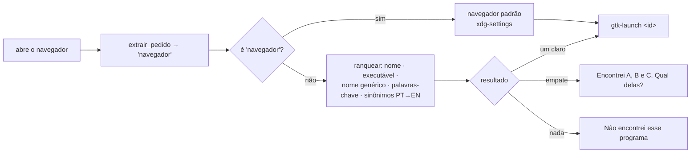

- **Origem dos programas:** só os registrados em arquivos `.desktop` (padrão XDG: usuário, sistema, Snap e Flatpak). A fala **nunca** vira comando de shell.
- **Sinônimos:** cobrem apps que só têm o nome em inglês no registro ("configurações" → *Settings*, "calculadora" → *Calculator*).
- **Prioridade:** no modo offline, os comandos de agenda vêm primeiro, então *"anota tarefa abrir conta no banco"* vira uma tarefa e não abre nada.

### 6. Máquina de estados

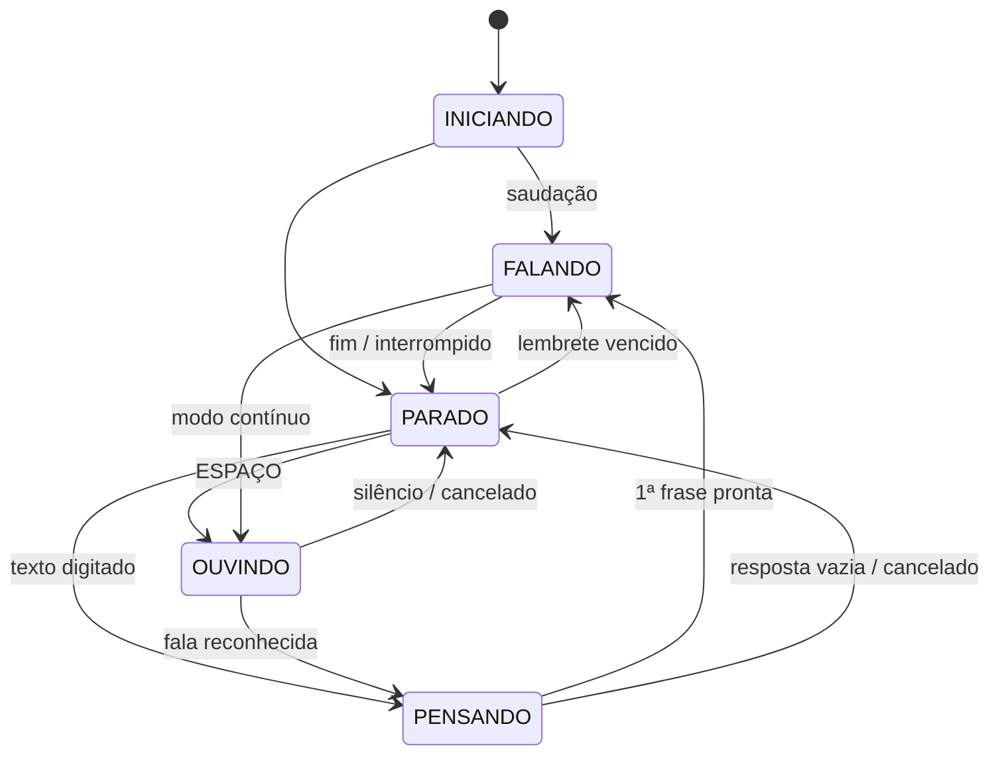

Transições fora deste grafo levantam `TransicaoInvalida`. Cada mudança vira um evento, e a interface interpola a cor do novo estado ao longo de cerca de 0,3 s.

### 7. Ferramentas do Claude (laço com streaming)

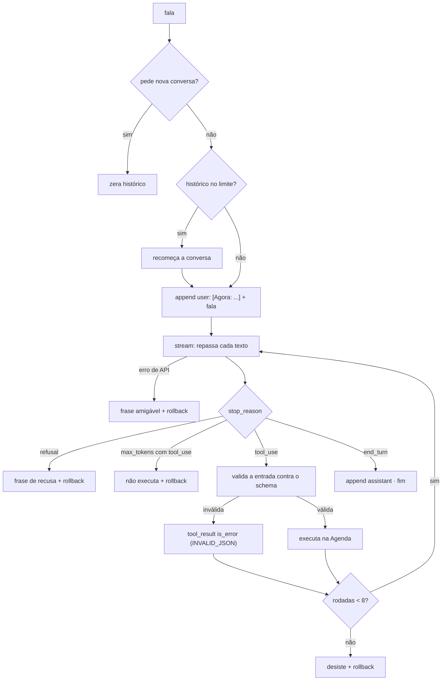

### 8. Animação da boca

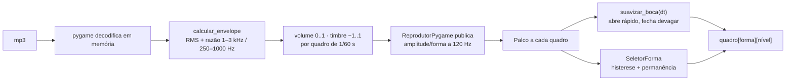

### 9. Renderização do avatar

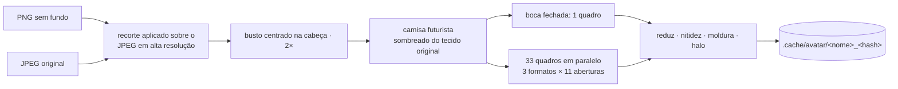

### 10. Lembretes no horário exato

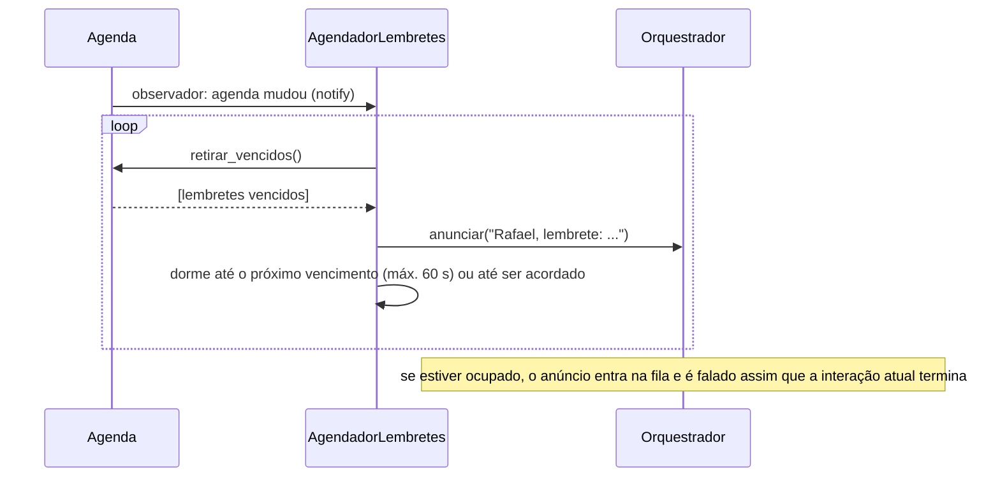

---

## Desempenho

Medições num i7-1165G7 sem GPU:

| Métrica | v1 | v2 |
|---|---|---|
| Janela visível após abrir | 0,5–4 s (avatar carregado na thread da interface) | **0,8 s** (avatar em segundo plano) |
| Primeira palavra (modo offline, texto) | resposta + voz inteiras | **~1,3 s** (só a 1ª frase) |
| Primeira palavra (Claude) | geração completa + síntese completa | **1ª frase gerada + sintetizada**; o resto em paralelo |
| Interromper | só durante a reprodução (pensando/sintetizando: ignorado) | **~10 ms em qualquer estágio** |
| Renderizar o avatar (sem cache) | 2,9 s / 4,3 s | **1,8 s / 2,2 s** (paralelo, em segundo plano) |
| Ler o avatar do cache | ~0,4 s | **0,08 s / 0,2 s** |
| Repetir uma fala (saudação, lembrete) | sintetizava de novo | **0,1 ms** (cache LRU) |
| Atraso de um lembrete | até 15 s (polling) | **< 0,1 s** (dorme até o vencimento) |
| Fim da fala do usuário | pausa fixa de 0,9 s | **0,7 s** + ruídos curtos ignorados |

Na versão 3.4 (medido no app real, depois da saudação, com o assistente parado):

| Métrica | 3.3 | 3.4 |
|---|---|---|
| CPU em repouso | 29% de um núcleo | **5%**: canvas diferencial, halo opaco e 30 FPS em repouso |
| Janela visível após abrir | 1,7–2,4 s (halos gerados na thread da interface) | **0,6 s** (halos em segundo plano) |
| Pausa entre frases faladas | ~1,2 s de silêncio embutido na voz sintetizada | **0,15 s** (silêncio das pontas aparado) |
| Saudação completa | ~10,1 s | **~8,5 s** |
| Trocar de avatar (tecla T) | engasgo de ~170 ms | **sem engasgo** (conversão aos poucos, 4 ms por quadro) |
| Frases curtas seguidas | esperavam a síntese da anterior | **2 sínteses em paralelo**, tocadas na ordem |

`tests/test_renderizacao.py` impede regressões: um palco em repouso precisa enviar menos de 80 comandos por segundo ao Tk, e as imagens grandes só podem ser redesenhadas poucas vezes por segundo.

---

## Decisões de arquitetura

| # | Decisão | Por quê |
|---|---|---|
| 1 | **Hexagonal com `Protocol`** | Troca de tecnologia (ex.: outro TTS) sem tocar no domínio; dublês triviais nos testes |
| 2 | **Pipeline em 3 estágios com filas** | A latência percebida passa a ser a da 1ª frase, não a da resposta inteira |
| 3 | **Um `Event` de cancelamento por interação**, criado de forma síncrona | Cancelamento instantâneo; nunca se perde nem reativa estágios antigos |
| 4 | **Barramento de eventos + despacho no laço de quadros** | Tk não é thread-safe; nenhuma thread de trabalho toca em widgets |
| 5 | **Máquina de estados explícita** | Estados impossíveis viram erro em vez de bug silencioso |
| 6 | **Histórico append-only com rollback por rodada** | Exigência dos blocos de raciocínio do Claude; o histórico nunca fica inconsistente |
| 7 | **`eager_input_streaming` + validação local das ferramentas** | Recomendado para streaming com ferramentas; entrada truncada ou inválida nunca é executada |
| 8 | **Data/hora na mensagem, instruções estáveis com `cache_control`** | Mantém o prefixo cacheável (custo e latência menores) |
| 9 | **`effort: low` + `fallbacks: "default"`** | Respostas faladas e curtas; se o modelo principal recusar, outro assume no servidor |
| 10 | **VAD próprio sobre o microfone** | Medidor real, cancelamento e pausa menor; o `listen()` da biblioteca é uma caixa-preta |
| 11 | **Escrita atômica + preservação de arquivo corrompido** | Queda de energia não corrompe a agenda; dados do usuário nunca são apagados |
| 12 | **Renderização prévia + cache com hash do código** | Animação só troca imagens (barata); o cache se invalida sozinho |
| 13 | **Testes de arquitetura** | A regra de dependência e os princípios SOLID não dependem de disciplina: o CI acusa a violação |
| 14 | **Despacho por tabela (intenções, ferramentas, períodos)** | Complexidade baixa e extensão sem edição do código existente |

---

## Desenvolvimento

```bash
make verificar      # lint (ruff) + tipos (mypy, assinaturas 100% tipadas) + 546 testes — o mesmo que a CI roda
make testar-rapido  # sem os testes marcados como "lento" (renderização e interface)
make cobertura      # relatório linha a linha
make formatar       # correções automáticas do ruff
make monografia     # gera a monografia (TCC, padrão ABNT) em docs/monografia/monografia.pdf
```

A documentação acadêmica do projeto (requisitos funcionais e não funcionais, arquitetura, passo a passo da construção, revisão SOLID e validação) está em [`docs/monografia/monografia.pdf`](docs/monografia/monografia.pdf), gerada a partir dos fontes LaTeX da mesma pasta.

| Suíte | O que garante |
|---|---|
| `test_agenda`, `test_repositorio_json` | Regras da agenda, transações (persiste e notifica só em sucesso), migração v1, escrita atômica, arquivo corrompido |
| `test_ferramentas`, `test_modelo_claude` | Schemas, validação (tipos, extras, `bool` ≠ `int`), streaming real, laço de ferramentas, `max_tokens`, recusa, erros da API, rollback ao interromper, limite de histórico |
| `test_modelo_offline` | Comandos, plural, lembretes relativos, despedida |
| `test_orquestrador` | **Prova do pipeline** (a 1ª frase toca antes de o modelo terminar), interrupção, modo contínuo, anúncios em fila, falhas de modelo/síntese/microfone, corrida do cancelamento |
| `test_frases`, `test_vad`, `test_estados_barramento`, `test_agendador` | Divisão de frases, detecção de fala, transições, entrega de eventos entre threads, lembrete acordando a thread na hora |
| `test_analise_audio`, `test_perfil_voz`, `test_adaptadores_voz` | Tom (±2%), envelope, timbre, perfil de voz, cache LRU do TTS, reprodutor |
| `test_avatar`, `test_animacao`, `test_configuracao_tema` | Busto centrado, camisa, cache, boca, suavização independente de FPS, cores |
| `test_ativacao` | Gramática de "ok Fael" e busca fonética com saídas reais do Vosk, frases parecidas que **não** podem disparar, extração do comando das saídas reais do Google, vigia liberando o microfone, retomada, lembrete durante a escuta, desligamento após falhas |
| `test_sqlite` | Esquema versionado, estado + histórico na mesma transação, rollback, triggers de somente acréscimo, **detecção de 4 tipos de adulteração**, consulta por período, concorrência, migração do JSON, preferências |
| `test_memoria` | 19 expressões de período em português, intenção "o que eu fiz", resumo (reaberta não conta), respostas, modo offline e ferramenta `consultar_historico` |
| `test_programas` | Leitura de `.desktop` (oculta, `TryExec`, ações, prioridade do usuário), extração do pedido, ranqueamento, sinônimos, ambiguidade, abertura sem shell, navegador padrão, prioridade da agenda no offline |
| `test_configuracoes` | Conversões de tom/ritmo, precedência preferência > perfil > padrão, **janela de tamanho fixo**, diálogo (ouvir, cancelar desfaz, salvar persiste e aplica avatar/voz/ativação) |
| `test_i18n` | Catálogo completo e com os mesmos campos nos dois idiomas, períodos e comandos em inglês, respostas em inglês (offline, memória, programas, Claude e erros), troca ao vivo (Claude recomeça, voz e gTTS trocam), saudação e lembrete em inglês, precedência de configuração |
| `test_bootstrap_ui` | Composição, queda para o modo offline e **a janela Tk real** com serviços simulados (pulado sem servidor gráfico) |
| `test_arquitetura` | **Regra de dependência entre camadas**, domínio sem bibliotecas de infraestrutura, contratos cumpridos pelo SQLite (LSP), `Agenda` com repositório em memória (DIP), tabelas extensíveis (OCP) e responsabilidades separadas (SRP) |
| `test_sessao_pipeline_vigia` | Pipeline de fala isolado (uma faixa por frase, cancelamento, falha do modelo), vigia isolada (entrega, liberação do microfone, desligamento após falhas) e aplicação das preferências |

A cobertura de domínio e aplicação fica entre 94% e 100%. Microfone e ALSA dependem de hardware e são verificados manualmente.

**Novo avatar:**
1. Coloque o PNG sem fundo (e, se tiver, o original em alta resolução) em `assets/avatares/`.
2. Adicione os pontos do rosto em [`catalogo.py`](src/robofael/avatar/catalogo.py).
3. Rode `make previa`.

## Dados e privacidade

- `dados/` (`memoria.db` com agenda, histórico e preferências; perfil e **gravações da sua voz**) e `.cache/` ficam fora do git.
- As fotos em `assets/avatares/` são pessoais: avalie antes de publicar o repositório.
- A escuta de "ok Fael" é **local** (Vosk): o que é falado no ambiente não sai do computador.
- Serviços externos:
  - **Google** recebe o áudio do microfone só depois da ativação (ESPAÇO ou "ok Fael"), para reconhecer o comando.
  - **Microsoft** (edge-tts) recebe o texto falado.
  - **Anthropic** recebe as conversas, quando o Claude está ativo.

## Solução de problemas

| Sintoma | Causa provável |
|---|---|
| "Claude indisponível; usando o modo offline" | `ANTHROPIC_API_KEY` ausente ou inválida |
| Aviso "Não consegui acessar o reconhecimento de voz" | Sem conexão com o Google Speech |
| Botão 🎤 desabilitado | Microfone não encontrado; use a caixa de texto |
| "Ativação por voz indisponível" | Falta o modelo local: `make baixar-modelo-voz` |
| Não reage a "ok Fael" | Rode com `ARGS="-v"`: se o *pico* da sua fala ficar abaixo de ~1000, o volume de entrada está baixo (`pactl get-source-volume @DEFAULT_SOURCE@`). Aumente para 80–100% ou escolha um microfone melhor nas configurações de som |
| Aviso "Sua voz está chegando baixa ao microfone" | Mesmo caso acima: o ganho automático ajuda, mas não substitui o volume de entrada |
| Ativa sozinho com conversas | Use `--sem-ativacao`, ou acrescente a frase que disparou aos distratores em `dominio/ativacao.py` |
| `jack server is not running` no terminal | Inofensivo (PyAudio procurando o JACK); `scripts/iniciar.sh` filtra |
| Barras não sobem ao falar | Microfone calibrado com ruído alto (reabra em ambiente silencioso) ou microfone errado: escolha outro em ⚙ → Microfone |
| ⚙ → Microfone só mostra "Padrão do sistema" | Sem `pactl` (`sudo apt install pulseaudio-utils`) ou sem PipeWire/PulseAudio |
| "Banco não encontrado em ..." ao abrir | O banco escolhido está num disco desconectado: conecte e reabra (até lá, vale o banco padrão) |
| Não abriu sozinho ao entrar no computador | Confira `~/.config/autostart/robofael.desktop`; sem a `ANTHROPIC_API_KEY` no ambiente da sessão, ele abre no modo local/offline |
| Logs detalhados | `make executar ARGS="-v"` |
| "Encontrei mais de uma opção…" ao abrir programa | Diga o nome mais específico (ex.: "abre o Firefox" em vez de "abre o navegador") |
| Desconfia que o histórico foi alterado | `make integridade` |
